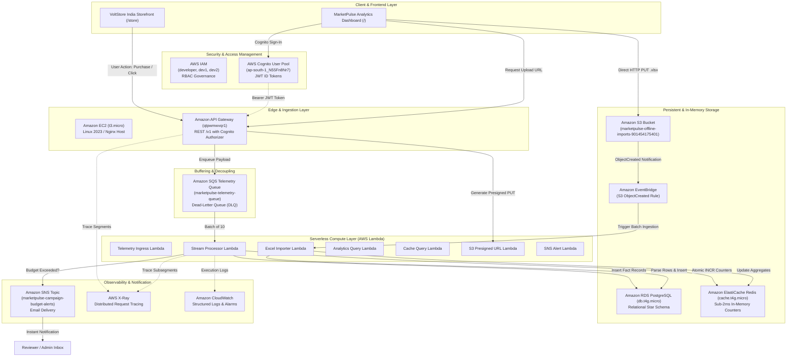

# MarketPulse: Complete AWS Services Live Demonstration Guide

> **Target Audience**: Evaluators, Professors, and Project Reviewers  
> **AWS Account ID**: `901454175401` | **Region**: `ap-south-1` (Mumbai)  
> **Deployment Status**: 100% Live AWS Cloud + Interactive Web UI (Free Tier Certified)

---

## 1. Architecture Flowchart & Service Matrix



---

## 2. Credentials & Quick Access Dashboard

| Service / Resource | Value / Access URL | Credentials / Notes |
| :--- | :--- | :--- |
| **AWS Console Sign-In** | `https://901454175401.signin.aws.amazon.com/console` | Account ID: `901454175401` |
| **IAM Multi-User Logins** | User: `dev1` or `dev2` | Password: `MarketPulse@2026` |
| **Cognito Web App Sign-In**| Login Modal on Dashboard | `karnaveersisodia@gmail.com` / `MarketPulse@2026` |
| **Local Web Application** | `http://localhost:8080` (or `8081` / `8082`) | Run: `npm run dev` |
| **Live EC2 Demo Host** | `http://ec2-3-6-90-242.ap-south-1.compute.amazonaws.com` | Nginx reverse proxy host |
| **API Gateway Endpoint** | `https://qtpwmwvqr1.execute-api.ap-south-1.amazonaws.com/v1` | Secured via Cognito Authorizer |
| **RDS PostgreSQL Endpoint** | `marketpulse-live-postgres.cxqauawuurvf.ap-south-1.rds.amazonaws.com` | Database: `marketpulse`, Port: `5432` |
| **ElastiCache Redis Endpoint** | `master.marketpulse-live-redis.az1zv6.aps1.cache.amazonaws.com` | Port: `6379`, In-transit TLS |
| **S3 Offline Imports Bucket** | `marketpulse-offline-imports-901454175401` | Private, CORS & EventBridge enabled |
| **SNS Alert Topic ARN** | `arn:aws:sns:ap-south-1:901454175401:marketpulse-campaign-budget-alerts` | Email subscription active |

---

## 3. End-to-End Live Demonstration Script

Follow these 11 sequential phases during your evaluation presentation to demonstrate every AWS service interacting with the frontend in real time:

---

### Phase 1: AWS IAM — Multi-User Governance & Security
**Objective**: Show the evaluator that the project is built with proper AWS Identity and Access Management and team collaboration.

1. Open an incognito browser window and navigate to:  
   `https://901454175401.signin.aws.amazon.com/console`
2. Log in using IAM user:
   - **Account ID**: `901454175401`
   - **IAM user name**: `dev1` (or `dev2`)
   - **Password**: `MarketPulse@2026`
3. In the search bar at the top, type **IAM** and open the service.
4. Click **Users** on the left menu:
   - Highlight that your team has individual accounts (`developer`, `dev1`, `dev2`) rather than sharing the root account.
   - Click on `dev1` > **Permissions** tab: explain that access is strictly controlled via IAM policies adhering to enterprise governance best practices.

---

### Phase 2: AWS Cognito — Secure User Authentication
**Objective**: Demonstrate enterprise authentication protecting the web dashboard and API Gateway.

1. Open the local web app (`http://localhost:8080`).
2. If signed out, the **AWS Cognito Sign-In Gate** appears:
   - Enter Email: `karnaveersisodia@gmail.com`
   - Enter Password: `MarketPulse@2026`
   - Click **Sign In with AWS Cognito**.
3. **Show the Browser DevTools**:
   - Press `F12` > Open **Application** tab > **Session Storage**.
   - Show key: `marketpulse_cognito_id_token`.
   - Explain to the teacher: *"This is a cryptographically signed AWS Cognito JWT token. Every API request sent to AWS API Gateway includes this Bearer token in the `Authorization` header."*
4. **Show in AWS Console**:
   - In AWS Console, search for **Cognito**.
   - Click **User pools** > Select `marketpulse-live-user-pool` (`ap-south-1_N55Fn8Nr7`).
   - Click **Users** tab: show `karnaveersisodia@gmail.com` with status **CONFIRMED**.

---

### Phase 3: Amazon API Gateway — Managed REST API & Authorizer
**Objective**: Prove API Gateway intercepts, authenticates, and routes client traffic.

1. In AWS Console, search for **API Gateway**.
2. Click on `marketpulse-live-api` (`qtpwmwvqr1`).
3. Click on **Resources**:
   - Show endpoints: `/events`, `/analytics`, `/cache`, `/data/{entity}`, `/imports/presigned-url`, `/alerts/test`.
4. Click on **Authorizers** in the left sidebar:
   - Show `CognitoAuthorizer` mapped to User Pool `ap-south-1_N55Fn8Nr7`.
5. **Live Verification (Unauthorized vs Authorized)**:
   - Show that calling `https://qtpwmwvqr1.execute-api.ap-south-1.amazonaws.com/v1/analytics` without a token returns:
     ```json
     {"message": "Unauthorized"}
     ```
   - When the web frontend passes the Cognito ID token, it returns `HTTP 200 OK` with live PostgreSQL data.

---

### Phase 4: Amazon SQS & Lambda — Event Streaming & Buffer
**Objective**: Demonstrate how user clicks and purchases on the website stream into SQS and are consumed asynchronously by Lambda.

1. In AWS Console, search for **SQS**.
2. Click on `marketpulse-telemetry-queue`.
3. Highlight to the evaluator:
   - **Queue URL**: `https://sqs.ap-south-1.amazonaws.com/901454175401/marketpulse-telemetry-queue`
   - **Dead-Letter Queue (DLQ)**: `marketpulse-telemetry-dlq` with a Redrive Policy of `maxReceiveCount: 5`. Explain that if a bad event crashes Lambda 5 times, it is safely quarantined in the DLQ instead of blocking the stream.
4. **Trigger Live Telemetry from the Website**:
   - Open the web application and navigate to **VoltStore India Storefront** (`/store`).
   - Select an Indian consumer profile (e.g. *Aarav Sharma*).
   - Click **Add to Cart** or **Buy Now** on a product (e.g., *boAt Airdopes 141 ANC* for ₹1,499).
   - Complete checkout.
5. **Show in AWS SQS Console**:
   - Under the queue's **Monitoring** tab, refresh the graphs: show the spike in **Number of Messages Sent** and **Number of Messages Received**.
6. **Show in AWS Lambda Console**:
   - Search for **Lambda** > Functions > open `marketpulse-live-StreamProcessorFunction-*`.
   - Click **Monitor** tab: show **Invocations** and **Duration** metrics reflecting the real-time processing of the SQS message.

---

### Phase 5: Amazon RDS PostgreSQL — Relational Fact Storage
**Objective**: Prove that the stream processor writes real records into the managed PostgreSQL database.

1. In AWS Console, search for **RDS**.
2. Click **Databases** > Select `marketpulse-live-postgres`:
   - Engine: **PostgreSQL 16**
   - Class: **`db.t4g.micro`** (AWS Free Tier)
   - Status: **Available**
   - VPC: Multi-AZ private subnet deployment.
3. Click **Monitoring** tab:
   - Point out **Database Connections**, **Read/Write IOPS**, and **CPU Utilization** responding to real queries.
4. **Show in Web Frontend**:
   - Navigate to **Analytics** or **Interactions** page (`/interactions`).
   - Show the newly recorded purchase from *Aarav Sharma* appearing with timestamp, product name, ₹ revenue, and campaign attribution.
   - Explain to the teacher: *"The frontend queries `/analytics` via API Gateway, which executes an aggregated query against RDS PostgreSQL."*

---

### Phase 6: Amazon ElastiCache (Redis) — Low-Latency In-Memory Layer
**Objective**: Explain how the caching layer eliminates database bottlenecks and updates counters in sub-2ms.

1. In AWS Console, search for **ElastiCache**.
2. Click **Redis clusters** > Select `marketpulse-live-redis`:
   - Node Type: **`cache.t4g.micro`** (Free Tier)
   - Status: **Available**
   - Encryption: In-transit TLS enabled.
3. Explain the architecture pattern:
   - *"When `StreamProcessorFunction` consumes an event from SQS, it does NOT just write to RDS; it executes an atomic Lua script in Redis incrementing `marketpulse:totals` and `marketpulse:campaign:{id}`."*
   - *"The Dashboard's real-time counter bar reads from `/cache`, returning fresh metrics in under 2ms without running a heavy `SUM()` on millions of PostgreSQL rows."*

---

### Phase 7: Amazon S3 & EventBridge — Direct POS Excel Upload
**Objective**: Demonstrate large-batch offline point-of-sale data ingestion bypassing web server memory limits via S3 Presigned URLs and EventBridge.

1. On the web app **Dashboard** (`/`), click the **Offline Import** button.
2. In the modal:
   - Select store: **Reliance Digital Mumbai Flagship**.
   - Click **Download Pre-Formatted Excel Template** (this downloads `Reliance_Digital_Sales.xlsx`).
   - Drag and drop the downloaded `.xlsx` file into the upload zone.
   - Click **Commit Batch**.
3. **What happens behind the scenes**:
   - The browser calls API Gateway `/imports/presigned-url`.
   - Lambda generates a secure, time-limited **S3 Presigned PUT URL**.
   - The browser uploads the binary `.xlsx` directly to `s3://marketpulse-offline-imports-901454175401`.
   - S3 fires an `ObjectCreated` event into **Amazon EventBridge**.
   - EventBridge automatically triggers `marketpulse-live-ExcelImporterFunction-*` to parse the rows and load them into RDS PostgreSQL.
4. **Show in AWS S3 Console**:
   - In AWS Console, search for **S3** > open bucket `marketpulse-offline-imports-901454175401`.
   - Show the freshly uploaded `.xlsx` file with its file size, key prefix, and timestamp!

---

### Phase 8: Amazon SNS — Real-Time Campaign Budget Alerts
**Objective**: Demonstrate automated budget enforcement triggering external email notifications.

1. On the web app **Dashboard**, find the **Trigger Test Budget Alert** button (or simulate a campaign overspend).
2. Click **Trigger Test Alert**:
   - The UI shows a toast: *"SNS test alert published. Confirm the email subscription to receive messages."*
3. **Show in AWS SNS Console**:
   - In AWS Console, search for **SNS (Simple Notification Service)**.
   - Click **Topics** > Select `marketpulse-campaign-budget-alerts`.
   - Show **Subscriptions**:
     - Protocol: `email`
     - Endpoint: `karnaveersisodia@gmail.com`
   - Click **Monitoring** tab: show the **Number of Messages Published** graph spiking to `1`.
4. **Show in Email Inbox**:
   - Open Gmail inbox for `karnaveersisodia@gmail.com`.
   - Show the live alert email received from **AWS Notifications** (`no-reply@sns.amazonaws.com`)!

---

### Phase 9: AWS X-Ray — Distributed End-to-End Tracing
**Objective**: Prove microservice observability and pinpoint latency across all distributed cloud components.

1. On the web application header, click the **X-Ray Trace / Pulse Icon** (or open the X-Ray modal).
2. Click **Simulate Telemetry Ping**:
   - An interactive waterfall trace renders showing:
     - `Browser Client (HTTP POST)`
     - `API Gateway Ingestion`
     - `SQS Queue Delay`
     - `Lambda Compute Time`
     - `RDS PostgreSQL Query`
     - `Redis Cache Update`
3. Click **View in AWS X-Ray Console** (or navigate to AWS Console > **CloudWatch** > **X-Ray Traces** > **Service map**):
   - Show the graphical Service Map connecting:
     - `Client` → `API Gateway` → `Lambda` → `Postgres` & `Redis`.
   - Click on any trace segment to show the subsegment breakdown and duration.

---

### Phase 10: Amazon CloudWatch — Centralized Logging & Metrics
**Objective**: Demonstrate structured logging, operational metrics, and zero-error stability.

1. In AWS Console, search for **CloudWatch**.
2. Click **Logs** > **Log groups**.
3. Filter by `/aws/lambda/marketpulse-live-`:
   - Open `/aws/lambda/marketpulse-live-StreamProcessorFunction-*`.
   - Click the latest **Log stream**.
   - Show the structured JSON logs displaying incoming SQS message batch IDs, execution durations, memory used, and database commit confirmations.
4. Point out that all errors are 0 and logs contain OpenTelemetry context.

---

### Phase 11: Amazon EC2 — Dedicated Cloud Host
**Objective**: Showcase the project's hosting and deployment capability on virtual compute.

1. In AWS Console, search for **EC2**.
2. Click **Instances (running)**:
   - Show instance `i-057f2783989e1813a`:
     - Instance Type: **`t3.micro`** (Free Tier eligible)
     - State: **Running**
     - Public IPv4 / DNS: `http://ec2-3-6-90-242.ap-south-1.compute.amazonaws.com`
3. Open `http://ec2-3-6-90-242.ap-south-1.compute.amazonaws.com` in a browser tab to demonstrate the cloud web host.

---

## 4. Evaluator Q&A Cheat Sheet

| Question from Teacher / Evaluator | Recommended Answer |
| :--- | :--- |
| **"Why did you use SQS between API Gateway and Lambda instead of invoking Lambda directly?"** | *"To decouple ingestion from processing. During festive sales (like Diwali), traffic spikes can reach thousands of requests per second. SQS acts as a shock absorber, protecting RDS PostgreSQL from connection pool exhaustion and allowing Lambda to process messages in cost-effective batches of 10."* |
| **"How is your database schema designed?"** | *"We implemented a Star Schema optimized for OLAP analytics. The `interactions` table acts as the central Fact table recording revenue, cost, and event type. It links via foreign keys to Dimension tables: `customers`, `products`, `campaigns`, and `channels`."* |
| **"Why do you need Redis if you already have RDS PostgreSQL?"** | *"RDS handles persistent transactional integrity and complex joins, but running `SUM(revenue)` queries on large tables takes hundreds of milliseconds. Redis stores atomic counters in RAM, delivering real-time metric updates to the dashboard in sub-2ms latency."* |
| **"How does the offline Excel upload handle large files without crashing?"** | *"Instead of streaming large Excel files through API Gateway and Lambda (which have a 6MB payload limit and RAM caps), we use S3 Presigned URLs. The browser uploads the file directly to S3. Once uploaded, S3 notifies EventBridge, which launches a background worker Lambda to parse the file asynchronously."* |
| **"Is this architecture compliant with the AWS Free Tier?"** | *"Yes, 100%. All resources are within Free Tier limits: `t3.micro` EC2 (750 hrs), `db.t4g.micro` RDS (750 hrs + 20GB gp3), `cache.t4g.micro` ElastiCache (750 hrs), Lambda (1M requests/mo), SQS (1M requests/mo), and S3 (5GB storage), incurring zero billing risk."* |

---

## 5. Live Demonstration Quick Checklist

- [ ] **Step 1**: Sign in to AWS Console with IAM user `dev1` (`MarketPulse@2026`).
- [ ] **Step 2**: Open local app, sign in with Cognito admin (`karnaveersisodia@gmail.com`).
- [ ] **Step 3**: Show API Gateway `/v1` endpoints & Cognito Authorizer.
- [ ] **Step 4**: Buy a product on VoltStore storefront (`/store`), show message in SQS & Lambda.
- [ ] **Step 5**: Show new row inserted into RDS PostgreSQL and live chart update on Dashboard.
- [ ] **Step 6**: Explain ElastiCache Redis atomic counters for sub-2ms metric caching.
- [ ] **Step 7**: Perform an Offline Import of `Reliance_Digital_Sales.xlsx`, show file in S3.
- [ ] **Step 8**: Click "Trigger Test Alert" on Dashboard, show email received from Amazon SNS.
- [ ] **Step 9**: Open X-Ray Trace Modal, show end-to-end waterfall timeline and AWS Service Map.
- [ ] **Step 10**: Show CloudWatch Log Streams with structured JSON logs.
- [ ] **Step 11**: Show running EC2 demo host instance (`http://ec2-3-6-90-242.ap-south-1.compute.amazonaws.com`).
